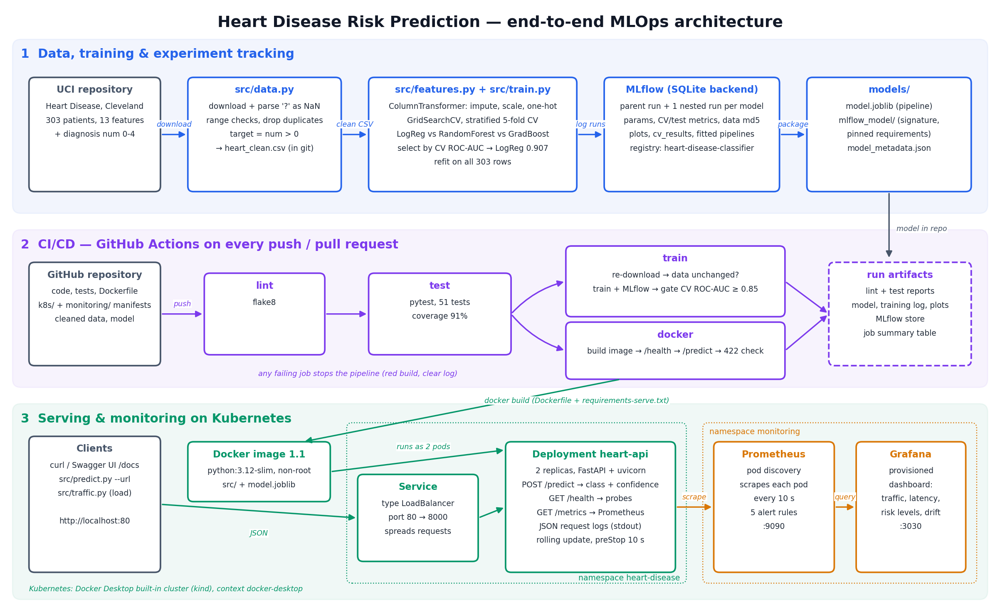

# Heart Disease Risk Prediction — End-to-End MLOps

**MLOps (AIMLCZG523) — Assignment 1** · Aditya Kumar · BITS ID 2025ae05701

## Deliverables

| Deliverable | Link |
|---|---|
| Code repository | https://github.com/onlyaditya/ml_ops_assignment_1 |
| Final report (10 pages) | [`reports/MLOps_Assignment1_Report.docx`](reports/MLOps_Assignment1_Report.docx) |
| Demo video of the pipeline | [video link] |
| API access (local, no public URL) | [Access instructions (local testing)](#access-instructions-local-testing) |
| Code, Dockerfile, requirements | [`src/`](src/) · [`Dockerfile`](Dockerfile) · [`requirements.txt`](requirements.txt) · [`requirements-serve.txt`](requirements-serve.txt) |
| Cleaned dataset + download script | [`data/processed/heart_clean.csv`](data/processed/heart_clean.csv) · [`src/data.py`](src/data.py) |
| Notebooks / scripts (EDA, training, inference) | [`notebooks/01_eda.ipynb`](notebooks/01_eda.ipynb) · [`src/train.py`](src/train.py) · [`src/predict.py`](src/predict.py) |
| Unit tests | [`tests/`](tests/) |
| GitHub Actions workflow | [`.github/workflows/ci.yml`](.github/workflows/ci.yml) · [CI runs](https://github.com/onlyaditya/ml_ops_assignment_1/actions) |
| Deployment manifests | [`k8s/`](k8s/) · [`monitoring/`](monitoring/) |
| Screenshots | [`screenshots/`](screenshots/) |

Predicts the presence of heart disease from patient health data (UCI Heart Disease dataset)
and serves the model as a containerised, monitored API.

## Architecture



Generated with `python reports/architecture_diagram.py`. The full write-up is in
[`reports/MLOps_Assignment1_Report.docx`](reports/MLOps_Assignment1_Report.docx).

## Access instructions (local testing)

There is no public URL — the API runs on the local Kubernetes cluster built into Docker Desktop.
To run the whole stack on your own machine:

**Prerequisites:** Python 3.12, Docker Desktop with *Settings → Kubernetes → Enable Kubernetes* switched on,
`kubectl` pointing at the `docker-desktop` context, and ports 80, 9090 and 3030 free.

```bash
# 1. get the code and the Python environment
git clone https://github.com/onlyaditya/ml_ops_assignment_1.git
cd ml_ops_assignment_1
python3.12 -m venv venv && source venv/bin/activate
pip install -r requirements.txt

# 2. build the API image (the trained model in models/ is copied into it)
docker build -t heart-disease-api:1.1 .

# 3. deploy the API and the monitoring stack
kubectl config use-context docker-desktop
kubectl apply -k k8s/
kubectl apply -k monitoring/
kubectl -n heart-disease rollout status deploy/heart-api
kubectl -n monitoring rollout status deploy/grafana

# 4. check that it answers
curl http://localhost/health
curl -X POST http://localhost/predict \
     -H "Content-Type: application/json" -d @samples/patient_high_risk.json
python -m src.predict samples/patients.json --url http://localhost

# 5. (optional) send traffic so the dashboard has data
python -m src.traffic --url http://localhost --rate 8 --duration 300
```

| What | URL |
|---|---|
| Prediction API (LoadBalancer) | http://localhost/predict (POST JSON) |
| Interactive API docs (Swagger UI) | http://localhost/docs |
| Health / model info / metrics | http://localhost/health · http://localhost/model-info · http://localhost/metrics |
| Prometheus | http://localhost:9090 |
| Grafana dashboard | http://localhost:3030 (opens without login; admin login `admin` / `heart-mlops`) |

Example request body (`samples/patient_high_risk.json`), all 13 UCI features:

```json
{"age": 58, "sex": 1, "cp": 4, "trestbps": 150, "chol": 270, "fbs": 0, "restecg": 2,
 "thalach": 111, "exang": 1, "oldpeak": 2.8, "slope": 2, "ca": 2, "thal": 7}
```

**Without Kubernetes**, the same image runs with plain Docker on port 8000:

```bash
docker run -d --name heart-api -p 8000:8000 heart-disease-api:1.1
curl http://localhost:8000/health      # Swagger UI: http://localhost:8000/docs
```

**Clean up:** `kubectl delete -k monitoring/ && kubectl delete -k k8s/` (and `docker rm -f heart-api`).

## Project structure

```
heart-disease-mlops/
├── data/
│   ├── raw/            # downloaded by script (not committed)
│   └── processed/      # cleaned dataset (committed)
├── notebooks/          # EDA notebook
├── src/                # data, training and API code
├── tests/              # pytest unit tests
├── models/             # final serialised model
├── k8s/                # Kubernetes manifests
├── monitoring/         # Prometheus / Grafana config, alert rules, dashboard
├── screenshots/        # images used in the report
├── reports/            # final report
└── .github/workflows/  # CI/CD pipeline
```

## Setup

Requires Python 3.12.

```bash
python3.12 -m venv venv
source venv/bin/activate
pip install -r requirements.txt
```

## Data

Source: [UCI Heart Disease](https://archive.ics.uci.edu/dataset/45/heart+disease) — Cleveland subset
(303 patients, 13 features + diagnosis).

```bash
python -m src.data          # downloads to data/raw/ and writes data/processed/heart_clean.csv
```

Cleaning steps (`src/data.py`):
- `?` markers parsed as missing (`ca`: 4 rows, `thal`: 2 rows)
- duplicate rows dropped, impossible clinical values nulled out
- diagnosis `num` (0–4) converted to binary `target` (0 = no disease, 1 = disease) → 164 / 139 split
- missing values are kept in the CSV and **imputed inside the model pipeline**, so training and inference use identical logic and no test-set statistics leak into training

## Exploratory Data Analysis

`notebooks/01_eda.ipynb` — figures are exported to `screenshots/eda/`.

```bash
jupyter notebook notebooks/01_eda.ipynb
```

Key findings: balanced classes (54/46); strongest signals are `thal`, `ca`, `exang`, `oldpeak`,
`cp` (positive) and `thalach` (negative); `fbs`/`chol` are weak; no strong multicollinearity
(max |r| = 0.58 between features); `cp`, `restecg`, `slope`, `thal` are nominal codes → one-hot encoding.

## Feature engineering & model training

```bash
python -m src.train
```

- **Preprocessing** (`src/features.py`) — one `ColumnTransformer`, saved inside the model pipeline:
  numeric → median impute + `StandardScaler`; binary → most-frequent impute;
  categorical (`cp`, `restecg`, `slope`, `thal`) → most-frequent impute + `OneHotEncoder(handle_unknown="ignore")`.
- **Validation**: stratified 80/20 train/test split; hyperparameters tuned with `GridSearchCV`
  using stratified 5-fold CV on the training set only.
- **Selection rule**: best mean CV ROC-AUC (the test set is only used for the final report).

| Model | CV ROC-AUC | CV accuracy | CV precision | CV recall | Test ROC-AUC | Test accuracy |
|---|---|---|---|---|---|---|
| **Logistic Regression** (C=0.3, L2, balanced) | **0.907 ± 0.019** | 0.855 | 0.882 | 0.801 | 0.961 | 0.869 |
| Random Forest (400 trees, min_leaf=3) | 0.901 ± 0.026 | 0.818 | 0.825 | 0.774 | 0.952 | 0.885 |
| Gradient Boosting (lr=0.03, depth=2) | 0.884 ± 0.027 | 0.822 | 0.851 | 0.756 | 0.960 | 0.902 |

Outputs: `reports/model_comparison.csv`, `reports/cv_results_<model>.csv` (every grid candidate),
ROC curves, confusion matrices and tuning plots in `screenshots/models/`.

## Experiment tracking (MLflow)

Every `python -m src.train` run is logged to a local MLflow store (`mlflow.db` + `mlruns/`, not committed):

- **Parent run `model-selection`** — data fingerprint (`data_md5`), split sizes, CV setup, the model
  comparison table, combined ROC curve, and the final packaged model.
- **One nested run per model family** — best hyperparameters, CV mean/std + test metrics,
  confusion matrix, grid-search plot, full `cv_results` table, and the fitted pipeline.
- **Model registry** — the final model is registered as `heart-disease-classifier` (new version per run).

```bash
mlflow ui --backend-store-uri sqlite:///mlflow.db    # then open http://127.0.0.1:5000
```

Set `MLFLOW_TRACKING_URI` to log to a remote tracking server instead.

## Model packaging

The selected configuration is **refit on all 303 rows** and saved to `models/`:

| File | Purpose |
|---|---|
| `models/model.joblib` | full preprocessing + classifier pipeline, loaded by the API |
| `models/mlflow_model/` | MLflow format (`MLmodel`, input signature, pinned requirements) — `mlflow.pyfunc.load_model("models/mlflow_model")` |
| `models/model_metadata.json` | model name, hyperparameters, feature order, data hash, CV/test performance estimate, MLflow run id & registry version |

Because imputation, scaling and one-hot encoding live inside the saved pipeline, raw patient
records (including missing values or unseen category codes) can be passed directly to `predict_proba`.

## Testing

```bash
pytest                                   # 51 tests
pytest --cov=src --cov-report=term-missing
```

| File | Covers |
|---|---|
| `tests/test_data.py` | `?` parsing, target binarisation, duplicates, out-of-range values, download skip/force (network mocked) |
| `tests/test_features.py` | column order/dtypes, imputation leaves no NaNs, scaling, one-hot width, unseen categories, missing columns |
| `tests/test_train.py` | model grids, CV summary, metrics range, learns better than chance, **end-to-end training run** in a temp dir (train → select → refit → save → reload → predict → report), quality gate |
| `tests/test_model_artifact.py` | packaged `models/` model: schema, probabilities, missing/unseen inputs, high-risk > low-risk patient |
| `tests/test_traffic.py` | traffic generator: payloads are valid JSON (ints for codes, null for missing), invalid share respected (network mocked) |
| `tests/test_api.py` | API contract: `/health`, `/model-info`, `/predict` output fields, null `ca`/`thal` accepted, invalid/unknown/missing fields → 422, risk bands, inference CLI = API; **monitoring**: prediction/validation-error counters, unknown URLs share one metric label, `X-Request-ID` propagation, JSON request log without patient data |

Tests use small synthetic datasets (`tests/conftest.py`), so they need no network and never touch `models/` or the MLflow store.

## CI/CD (GitHub Actions)

`.github/workflows/ci.yml` runs on every push to `main`, every pull request, and manually:

```
lint (flake8) ──► test (pytest + coverage) ──┬─► train  (data → train → quality gate)
                                             └─► docker (build image → run → smoke-test /predict)
```

| Job | Steps | Artifacts |
|---|---|---|
| **lint** | `flake8` (config in `.flake8`) | `lint-report` |
| **test** | install `requirements.txt` → `pytest` with JUnit XML + coverage | `test-results` (junit.xml, coverage.xml) |
| **docker** | `docker build` → run container → wait for `/health` → POST `samples/patient_high_risk.json` (expects class 1) → invalid input must return 422 | container logs in the job output |
| **train** | `python -m src.data --force` → verify cleaned CSV is identical to the committed one → `python -m src.train` → `python -m src.ci_report` (fails if CV ROC-AUC < 0.85; model table written to the job summary) | `model`, `training-reports` (log, CSVs, plots), `mlflow-tracking` (mlflow.db + mlruns) |

Each job depends on the previous one, so any lint error, failing test, data drift or below-threshold
model stops the pipeline with a red build and the failing step's log.

## Inference & serving API

### Inference script

```bash
python -m src.predict samples/patient_high_risk.json                        # local model
python -m src.predict samples/patients.json                                 # a list of patients
python -m src.predict samples/patients.json --url http://localhost:8000     # same, via the API
```

`src/predict.py::score_records` is the only place that turns raw records into predictions;
both the CLI and the API call it, so they always agree.

### FastAPI service (`src/api.py`)

```bash
uvicorn src.api:app --reload        # interactive docs at http://127.0.0.1:8000/docs
```

| Endpoint | Purpose |
|---|---|
| `GET /health` | liveness/readiness check (Docker `HEALTHCHECK`, Kubernetes probes) |
| `GET /model-info` | served model version, hyperparameters, features, CV/test performance estimate |
| `GET /metrics` | Prometheus metrics (see [Monitoring & logging](#monitoring--logging)) |
| `POST /predict` | one patient (JSON) → prediction, confidence, risk level |

```bash
curl -X POST http://localhost:8000/predict \
     -H "Content-Type: application/json" -d @samples/patient_high_risk.json
```
```json
{"prediction": 1, "label": "heart disease", "confidence": 0.9961,
 "probability_disease": 0.9961, "risk_level": "high", "model_version": "logistic_regression-v1"}
```

- `confidence` = probability of the predicted class; `risk_level` bands P(disease): < 0.3 low, < 0.7 moderate, otherwise high.
- **Input validation** (pydantic): categorical codes must be valid UCI codes (e.g. `cp` ∈ 1–4, `thal` ∈ {3, 6, 7}),
  numeric values must lie in the same plausible clinical ranges used during data cleaning, and unknown fields
  are rejected → HTTP 422 with a field-level message. Only `ca` and `thal` (missing in the real data) may be `null`;
  the model pipeline imputes them.
- Settings via environment variables: `MODEL_PATH`, `PREDICTION_THRESHOLD` (default 0.5), `LOG_LEVEL` (default INFO).

### Docker

The image contains only the serving code and the model (`requirements-serve.txt` — no MLflow, Jupyter or plotting
libraries), runs as a non-root user and has a built-in health check.

```bash
docker build -t heart-disease-api:1.1 .
docker run -d --name heart-api -p 8000:8000 heart-disease-api:1.1
curl http://localhost:8000/health
python -m src.predict samples/patients.json --url http://localhost:8000
docker logs heart-api
```


## Kubernetes deployment

Target: the local Kubernetes cluster built into Docker Desktop (context `docker-desktop`).
Manifests live in `k8s/` and are applied together with Kustomize.

| File | What it defines |
|---|---|
| `k8s/namespace.yaml` | namespace `heart-disease` (whole app can be inspected or deleted at once) |
| `k8s/configmap.yaml` | runtime settings (`PREDICTION_THRESHOLD`) injected as environment variables |
| `k8s/deployment.yaml` | 2 replicas of `heart-disease-api:1.1`, rolling updates with `maxUnavailable: 0`, readiness + liveness probes on `/health`, CPU/memory requests and limits, non-root read-only container, `preStop` delay for graceful shutdown |
| `k8s/service.yaml` | `LoadBalancer` service, port 80 → container port 8000 |
| `k8s/kustomization.yaml` | lists the above so one command deploys everything |

```bash
docker build -t heart-disease-api:1.1 .        # the cluster uses the local image (no registry)
kubectl apply -k k8s/
kubectl -n heart-disease rollout status deploy/heart-api
kubectl -n heart-disease get pods,svc

curl http://localhost/health
python -m src.predict samples/patients.json --url http://localhost
```

On Docker Desktop the LoadBalancer is published on `localhost`, so the API is at **http://localhost/**
(Swagger UI: http://localhost/docs). Useful operations:

```bash
kubectl -n heart-disease logs -l app.kubernetes.io/name=heart-api --prefix   # logs from both pods
kubectl -n heart-disease rollout restart deploy/heart-api                    # zero-downtime restart
kubectl -n heart-disease scale deploy/heart-api --replicas=3
kubectl delete -k k8s/                                                       # remove everything
```

Verified behaviour: requests are spread across both pods; a deleted pod is replaced automatically
within seconds; a rolling restart under continuous traffic (≈ 7 requests/s) completed with
**0 failed requests out of 868**. Without the `preStop` delay the same test lost ~2% of requests,
because a terminating pod stopped accepting connections before the load balancer had removed it.

## Monitoring & logging

### Request logging (`src/monitoring.py`)

Every request is logged as one JSON line on stdout with a request id (taken from an incoming
`X-Request-ID` header or generated, and returned in the response header):

```json
{"ts": "2026-10-20T07:28:49.975+00:00", "level": "INFO", "logger": "heart_api", "msg": "prediction",
 "request_id": "5c8cd3b2ff51", "prediction": 1, "probability_disease": 0.667, "risk_level": "moderate",
 "model_version": "logistic_regression-v1"}
{"ts": "2026-10-20T07:28:49.976+00:00", "level": "INFO", "logger": "heart_api", "msg": "request",
 "request_id": "5c8cd3b2ff51", "method": "POST", "path": "/predict", "status": 200, "latency_ms": 7.88,
 "client": "10.244.0.1"}
```

- Rejected inputs log a `validation error` warning listing the offending fields.
- **Patient feature values are never logged** — only request metadata and the model's output.
- `/health` and `/metrics` calls are logged only at `LOG_LEVEL=DEBUG` (probes and scrapes would drown everything else).
- uvicorn's plain-text access log is replaced by these JSON lines.

```bash
kubectl -n heart-disease logs -l app.kubernetes.io/name=heart-api --prefix -f
```

### Metrics (`GET /metrics`)

| Metric | Type | Labels | Answers |
|---|---|---|---|
| `heart_api_requests_total` | counter | method, endpoint, status | traffic and error rate |
| `heart_api_request_duration_seconds` | histogram | endpoint | latency percentiles |
| `heart_api_predictions_total` | counter | prediction, risk_level | what the model is answering |
| `heart_api_prediction_probability` | histogram | – | distribution / mean of P(disease) → drift |
| `heart_api_validation_errors_total` | counter | field | which inputs clients get wrong |
| `heart_api_model_info` | gauge | model_version, threshold | which model is live |

Unknown URLs are counted under `endpoint="other"`, so scanners or typos cannot create unlimited label values.

### Prometheus + Grafana on Kubernetes (`monitoring/`)

```bash
kubectl apply -k k8s/              # API (pods carry prometheus.io/* scrape annotations)
kubectl apply -k monitoring/       # Prometheus + Grafana in namespace "monitoring"
python -m src.traffic --url http://localhost --rate 8 --duration 300   # generate traffic
```

| URL | What |
|---|---|
| http://localhost:9090 | Prometheus — *Status → Targets* shows both API pods, *Alerts* shows the rules |
| http://localhost:3030 | Grafana — opens on the **Heart Disease API** dashboard (anonymous read-only; admin login `admin` / `heart-mlops`) |

- **Discovery:** Prometheus finds API pods through the Kubernetes API (`kubernetes_sd_configs`, role `pod`) and scrapes
  each pod separately, so a failing pod shows up as `up == 0` instead of being hidden behind the Service.
  It only has a namespaced `Role` to list pods in `heart-disease` (least privilege).
- **Provisioning as code:** the Grafana data source and the dashboard JSON (`monitoring/grafana/`) are loaded at
  start-up; Kustomize turns the plain config files into ConfigMaps with a content hash, so editing a file and
  re-applying restarts the affected pod automatically.
- **Dashboard panels:** pods up, request rate, rejected-request %, p95 latency, model version; request rate by
  endpoint/status; p50/p95/p99 latency; predictions per minute by risk level; risk-level share; mean predicted
  probability vs the 45.9% training base rate (drift indicator); probability distribution; rejected inputs by field;
  requests per pod (load balancing); memory per pod.
- **Alert rules** (`monitoring/alerts.yml`, shown in the Prometheus UI): pod down, > 1% server errors,
  p95 latency > 250 ms, > 20% rejected inputs, mean predicted probability far from the training base rate for 30 min.
- `src/traffic.py` replays real patients from the cleaned dataset (5% deliberately invalid) to populate the dashboard.

